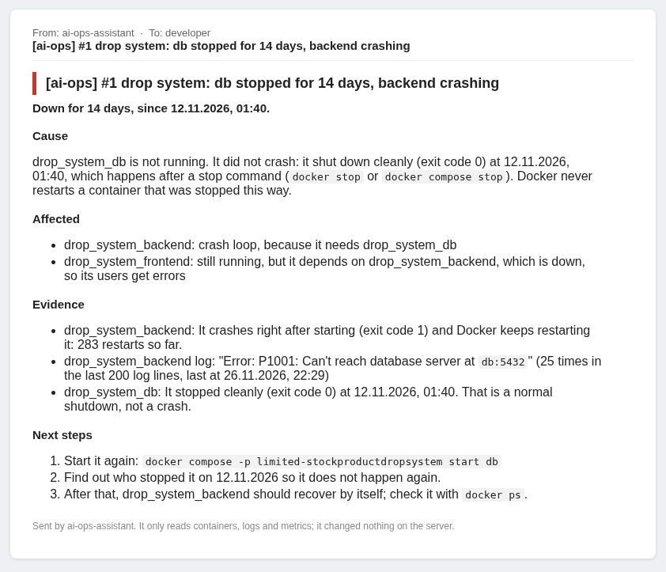
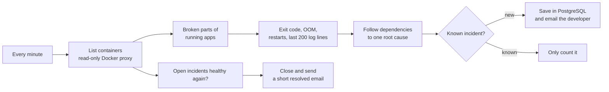
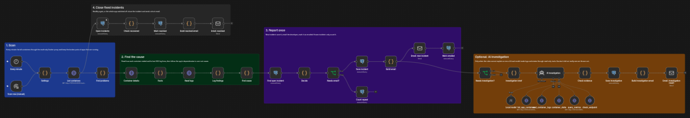
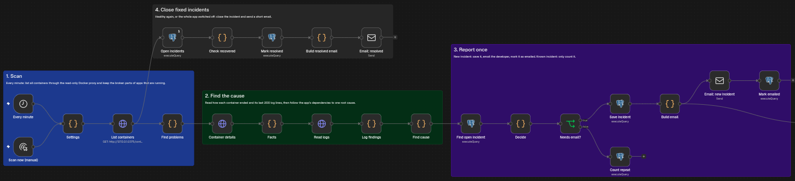
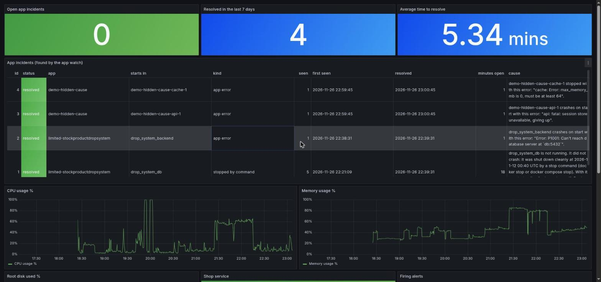
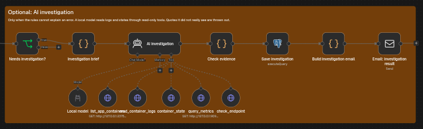

# ai-ops-assistant

A self-hosted watcher for Docker apps. When a part of an app crashes, it finds the cause from the evidence on the server and emails the developer one clear report: what broke, why, what else is affected, and what to do next.

It runs next to your apps on any Linux server with Docker. It is built with n8n, PostgreSQL and a read-only Docker proxy. An optional local AI model can investigate errors the rules cannot explain.



Short overview in 8 slides: [docs/presentation/AI_Ops_Assistant.pdf](docs/presentation/AI_Ops_Assistant.pdf)

## Contents

- [Why](#why)
- [How it works](#how-it-works)
- [What it can find](#what-it-can-find)
- [Setup](#setup)
- [Configuration](#configuration)
- [Dashboard](#dashboard)
- [AI investigation (optional)](#ai-investigation-optional)
- [Security](#security)
- [Tests](#tests)
- [Results from real runs](#results-from-real-runs)
- [Project structure](#project-structure)
- [Next steps](#next-steps)

## Why

When an app breaks in production, the first alert usually says only "service down". The developer then spends the first minutes collecting facts: which container stopped, what the logs say, whether the database is still running, and whether this is one problem or several.

ai-ops-assistant does that first round of investigation automatically, every minute, and sends the result. The cause is decided by checks and rules on real evidence. It is never guessed by a language model.

## How it works



The whole flow is one n8n workflow, divided into four stages:





1. **Scan.** Every minute, list all containers through the read-only Docker proxy. Containers are grouped by Docker Compose project. An app whose containers are all stopped counts as switched off on purpose and is not reported.
2. **Find the cause.** For every broken container, read how it ended (exit code, OOMKilled, restart count, stop time) and its last 200 log lines. Error lines are grouped and counted, and the first stack frame in the app's own code gives the file and line. Then the dependencies are followed: from `depends_on` in the compose file, and from service names that appear in the logs (for example `db:5432`). A backend that crashes because its database is stopped becomes one incident with the database as the root cause, not two.
3. **Report once.** A new incident is saved and emailed. While the problem lasts, later scans only count it. If sending the email fails, the next scan tries again.
4. **Close fixed incidents.** When the containers are healthy again, or the whole app was switched off, the incident is closed and a short "resolved" email is sent.

## What it can find

| Situation | Evidence used | Example of the cause in the email |
|---|---|---|
| A dependency is down | stopped container plus `depends_on` or its name in the logs | "drop_system_db is not running. It did not crash: it shut down cleanly ..." |
| Stopped on purpose | exit code 0 and restart policy | "... which happens after a stop command (`docker stop` or `docker compose stop`)" |
| Out of memory | `OOMKilled`, memory limit | "worker was killed by the system because it ran out of memory (limit 512 MB)" |
| Bug in the code | error line plus stack trace | "A bug in the app code: TypeError ... at src/orders/orderService.ts:87" |
| Port already in use | `EADDRINUSE` | "The port the app wants is already used by another process" |
| Wrong credentials | `password authentication failed` | "The app is using a wrong password or user for a service it connects to" |
| Missing setting | missing environment variable | "A required setting (environment variable) is missing" |
| Disk full | `no space left on device` | "The disk is full, so the app cannot write" |
| Missing file or module | `ENOENT`, `module not found` | "A file or module the app needs does not exist in the container" |

Two rules keep the reports honest:

- **Evidence must fit the time of the event.** A shutdown message from another day is not used as proof.
- **Recovering is not a new problem.** If every error is older than the restart of the part it complains about, the container is only waiting for Docker's next restart, and no email is sent.

When there is an error but no rule explains it, the email shows the error and the log location, and the optional AI investigation can take over.

## Setup

### Requirements

- A Linux server or computer with Docker and Docker Compose v2
- An email account that can send through SMTP. For Gmail you need an **app password** (see step 2).
- About 1 GB of free RAM for n8n and PostgreSQL

### 1. Get the code

```bash
git clone https://github.com/omar-radwan7/AI-ops-assistant.git
cd AI-ops-assistant
```

### 2. Create a Gmail app password

Gmail does not accept your normal password for SMTP. It needs an app password that Google creates for you.

1. Turn on 2-step verification at https://myaccount.google.com/security (if it is not on yet).
2. Open https://myaccount.google.com/apppasswords, enter a name such as `ai-ops`, and click **Create**.
3. Copy the 16 letters Google shows. You will not see them again.

Other mail providers work too: use their SMTP host, port, user and password.

### 3. Create the configuration

```bash
./install.sh
```

The first run creates `.env` from `.env.example` and stops. Open it and fill in at least these values:

```ini
ALERT_EMAIL_TO=you@example.com
SMTP_HOST=smtp.gmail.com
SMTP_PORT=465
SMTP_USER=you@gmail.com
SMTP_PASSWORD=abcdefghijklmnop     # the app password, no spaces
```

`.env` holds passwords. It is excluded from Git and the installer sets its permissions to 600.

### 4. Install

```bash
./install.sh
```

The installer:

1. generates the database passwords (once, never printed)
2. starts the containers chosen in `COMPOSE_PROFILES`
3. creates or upgrades the database tables
4. builds the n8n credentials and workflows from `.env`, imports them and publishes them
5. removes the temporary files that contain passwords

Run it again after every change to `.env`. It is safe to repeat.

### 5. Check that it works

- Open n8n. It only listens on the server itself, so from your computer use an SSH tunnel:
  ```bash
  ssh -L 5678:127.0.0.1:5678 your-server
  ```
  Then open http://localhost:5678. The workflow **AI Ops: app watch** should show **Published**.
- Trigger a test incident with the included demo app, which crashes on purpose:
  ```bash
  docker compose -f tests/scenarios/hidden-cause/docker-compose.yml up -d
  ```
  An email arrives within about a minute. Stop the demo app and a "resolved" email follows:
  ```bash
  docker compose -f tests/scenarios/hidden-cause/docker-compose.yml stop
  ```

### Using an n8n you already run

If the server already has n8n, remove `n8n` from `COMPOSE_PROFILES` and set `N8N_CONTAINER` to the name of your n8n container. The installer imports into that instance and restarts it once. Your other workflows are not touched.

## Configuration

All settings live in `.env`. After a change, run `./install.sh` again.

| Setting | Default | Meaning |
|---|---|---|
| `ALERT_EMAIL_TO` | | Who receives the reports |
| `ALERT_EMAIL_FROM` | SMTP user | Sender address |
| `SMTP_HOST`, `SMTP_PORT` | `smtp.gmail.com`, `465` | Mail server. Port 465 uses SSL/TLS. |
| `SMTP_USER`, `SMTP_PASSWORD` | | Mail login. For Gmail an app password. |
| `IGNORE_APPS` | `ai-ops-assistant` | Compose projects that are never watched, comma separated |
| `APP_LABELS` | | Short names for the email subject, for example `my-shop-prod=shop,blog=blog` |
| `SCAN_EVERY_MINUTES` | `1` | How often to scan (1 to 60) |
| `TIMEZONE` | `Europe/Berlin` | Time zone for the times in the emails |
| `AI_INVESTIGATION` | `off` | `off` or `local` (see below) |
| `OLLAMA_URL`, `OLLAMA_MODEL` | `http://127.0.0.1:11434`, `qwen3:8b` | Model for the AI investigation |
| `COMPOSE_PROFILES` | `n8n` | Optional parts to run: `n8n`, `metrics`, `demo` |
| `N8N_CONTAINER` | `ai-ops-n8n` | The n8n container to install into |

Every Docker Compose app on the machine is watched automatically. There is nothing to register per app.

### Optional parts (profiles)

| Profile | Starts | Use it when |
|---|---|---|
| (always) | read-only Docker proxy, PostgreSQL | |
| `n8n` | n8n 2.49 | the server has no n8n yet |
| `metrics` | Prometheus, Alertmanager, node-exporter, Grafana, plus a second workflow for server alerts (CPU, memory, disk) | you want server health and the dashboard |
| `demo` | a small demo service for the server alerts | testing |

## Dashboard

With the `metrics` profile, Grafana shows the app incidents next to the health of the server: open incidents, incidents resolved in the last 7 days, the average time to resolve, and the full history with the cause of each incident.



Grafana listens on 127.0.0.1:3000. Use an SSH tunnel as for n8n.

## AI investigation (optional)



Some errors name no other part of the app, for example `fatal: session store unavailable`. The rules can report the error but not the reason. With `AI_INVESTIGATION=local`, an n8n AI Agent with a local Ollama model takes over:

- It gets five read-only tools: list the app's containers, read a container's logs, read a container's state, query Prometheus, and call an HTTP endpoint of the app.
- It answers in a fixed JSON format with the cause, the evidence and next steps, at most 6 steps.
- **Every quote it gives as evidence is checked against the real tool results.** Claims that do not appear in any tool result are thrown out and listed as "thrown out" in the email.
- The first email is sent before the investigation starts. The investigation result follows in a second email, so a slow model never delays the alert.

**Honest status:** on a laptop without a GPU this is too slow. qwen3:8b read about 15 tokens per second, and one investigation did not finish within 25 minutes. In an earlier test the model answered without calling any tool and named a database container that did not exist. The evidence check caught it and dropped every claim. Use this option only on a machine with a GPU, or leave it `off`. The rules work fully without it.

## Security

- **Read-only Docker access.** The workflow never touches the Docker socket. It goes through [docker-socket-proxy](https://github.com/Tecnativa/docker-socket-proxy) with `POST=0`: listing containers, details and logs works, while starting, stopping or deleting is blocked (tested: a stop request returns 403).
- **Nothing is exposed.** n8n, PostgreSQL, Grafana, Prometheus and the proxy listen on 127.0.0.1 only.
- **Secrets stay in `.env`.** It is excluded from Git with permissions 600. Rendered credential files are deleted after import, also when the install fails.
- **It never fixes anything by itself.** Reports suggest commands; a person runs them.

## Tests

The rule and email logic has offline tests that run the code from the workflow file directly:

```bash
node tests/find_cause.test.js   # 11 cases: root cause, dependency chains, OOM, code bugs, recovering, ...
node tests/emails.test.js       # 5 cases: subject, escaping, duration, resolved email, recovery check
```

Examples of what they check: two separate problems stay separate, a password error is not blamed on a database that is running, and a log line from another day is not used as evidence.

`tests/scenarios/hidden-cause` is a small app that crashes on purpose, for end to end tests.

## Results from real runs

Tested on a laptop with real projects:

- A real outage was found on the first scan: the database of one app had been stopped for 14 days, and its backend had restarted 196 times. The report named the stopped database as the root cause, listed the backend and frontend as affected, and gave the start command.
- After the database was started, the backend recovered, both incidents closed by themselves within a minute, and "resolved" emails were sent.
- That same test exposed a false alarm: one scan saw old error lines while the backend waited for its next restart and reported it as a new problem. The "recovering" rule now prevents this, with a test for each case.
- A second bug found by testing: an incident was saved, but its email failed, so later scans treated it as already reported. Incidents now count as reported only after the email is sent.
- After a full install with `install.sh`, a crash of the demo app produced two emails within a minute, and stopping it produced two "resolved" emails.

## Project structure

```
.
├── install.sh                  one-command install and upgrade
├── docker-compose.yml          services and profiles
├── .env.example                configuration template
├── n8n/
│   ├── app-watch.json          the app watch workflow (scan, cause, report, close, AI)
│   └── alert-triage.json       server alert workflow for the metrics profile
├── scripts/
│   ├── render.js               builds credentials and workflows from .env
│   └── cpu_stress.sh           load test for the server alerts
├── db/init.sql                 tables (safe to run again)
├── grafana/                    dashboard and data sources
├── prometheus/, alertmanager/  server metrics and alert rules
├── runbooks/                   short runbooks used by the server alert workflow
├── demo/                       demo service for the server alerts
├── tests/                      offline tests and the crash scenario
└── docs/images/                screenshots for this README
```

## Next steps

- Run the AI investigation on a machine with a GPU and measure how often it finds the right cause.
- An "approve fix" button in the email: the suggested command runs only after a person clicks it.
- A daily summary email with open and resolved incidents.
- More notification channels (Slack, Telegram) next to email.
